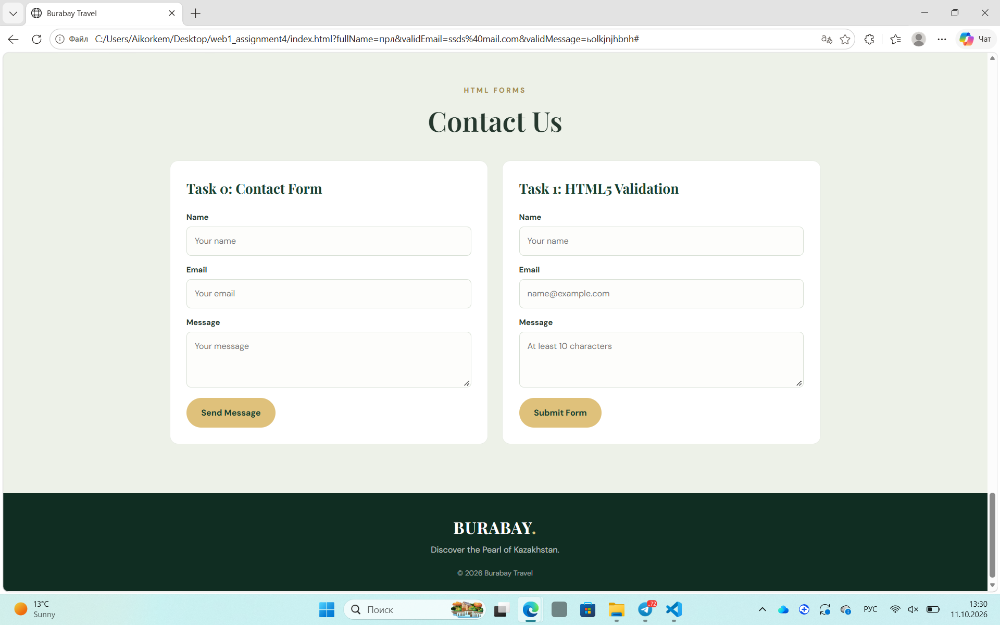
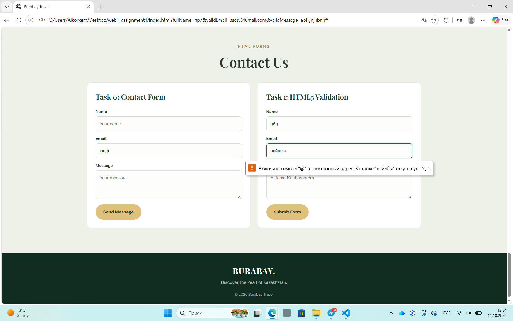
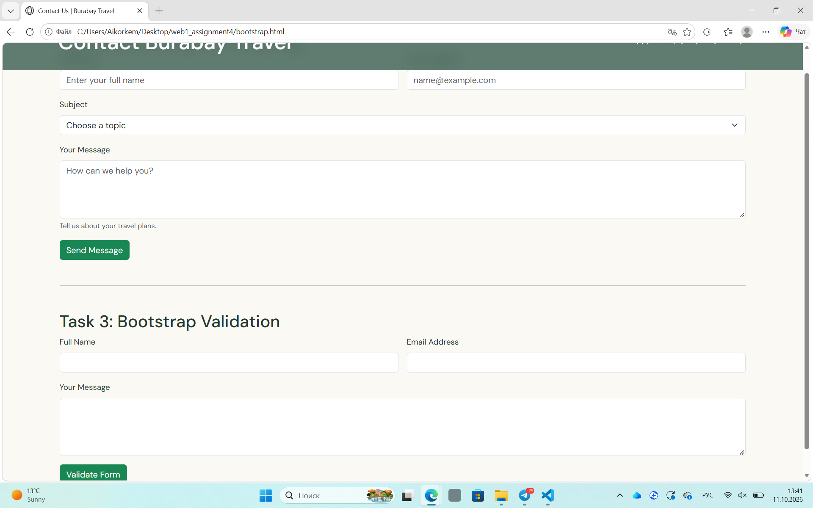
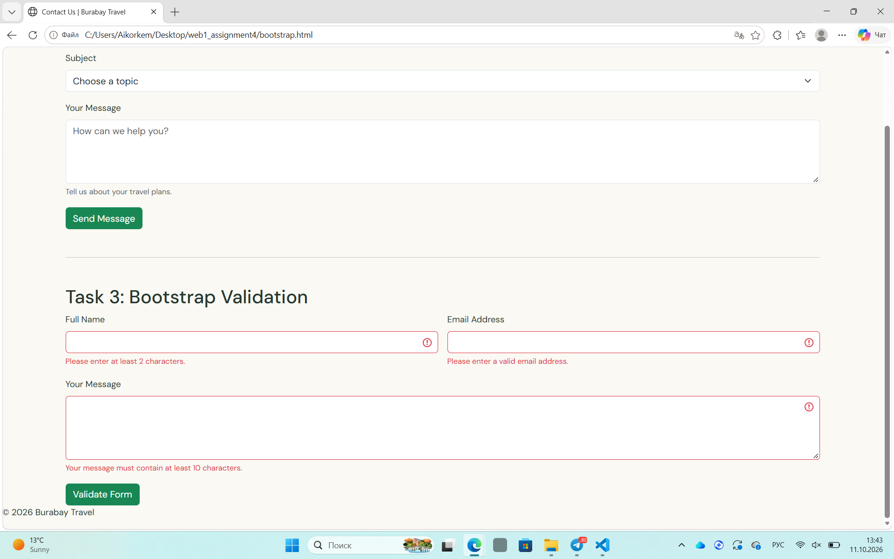
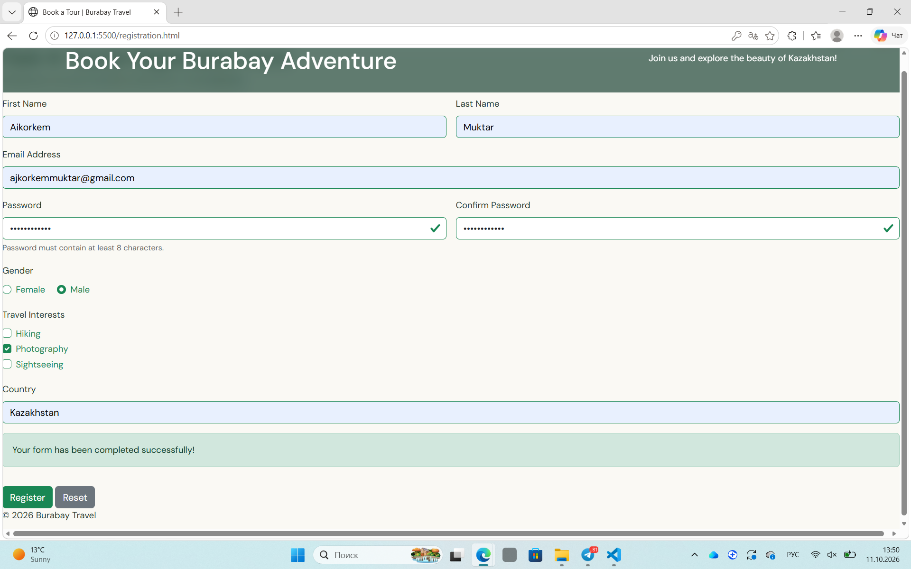
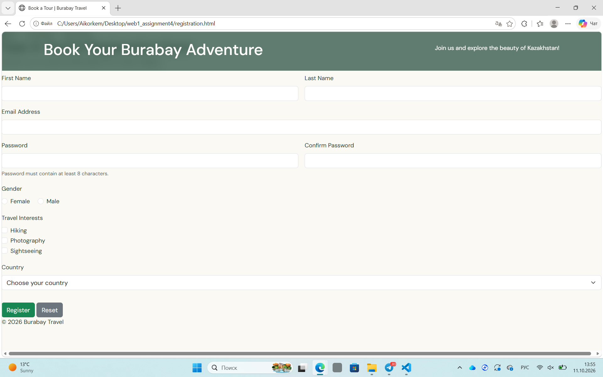
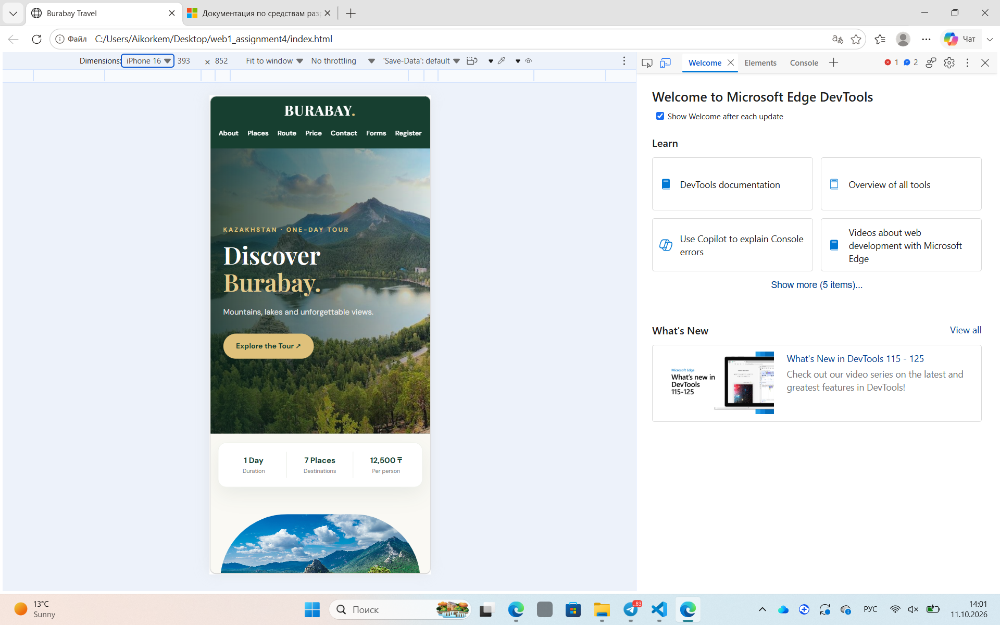

Burabay Travel — HTML Forms and Validation 

Github Pages: https://aikorkem07.github.io/web1/

Github link:https://github.com/Aikorkem07/web1.git

Muktar Aikorkem IT-2513

Project Description

Burabay Travel is a tourism website about Burabay, Kazakhstan. It provides information about tourist attractions, travel routes, and booking options. The project demonstrates HTML forms, HTML5 validation, Bootstrap styling, and JavaScript validation.

Technologies

- HTML5
- CSS3
- Bootstrap 5.3.3
- JavaScript
- Formspree
- Visual Studio Code

Project Files

- index.html — main website, Contact Form (Task 0), HTML5 Validation (Task 1)
- bootstrap.html — Bootstrap Form Styling (Task 2) and Bootstrap Validation (Task 3)
- registration.html — Registration Form (Task 4)
- style.css — website styling
- foto1.jpg–foto10.jpg — website images

Task 0: Basic Contact Form

Created a contact form with Name, Email, and Message fields. Formspree is used to receive submitted messages by email.

Task 1: HTML5 Validation

Added HTML5 validation to prevent users from submitting incomplete or incorrectly formatted data.

Task 2: Bootstrap Form Styling

Used Bootstrap 5.3.3 to style the form and make it responsive. Added form controls, placeholders, helper text, and a responsive grid layout.

Task 3: Bootstrap Validation

Implemented validation feedback using Bootstrap and JavaScript to help users identify invalid input.

Task 4: Registration Form

Created a registration form with First Name, Last Name, Email, Password, Confirm Password, Gender, Hobbies, and Country fields. Added Submit and Reset buttons, responsive layout, and password confirmation validation.

How to Run

1. Open the project folder in Visual Studio Code.
2. Install the Live Server extension.
3. Open index.html and click Go Live.
4. Open bootstrap.html and registration.html to test the other tasks.
5. Use an internet connection to load Bootstrap from its CDN.

Testing

- Tested required fields and email validation.
- Tested Bootstrap form styling and validation feedback.
- Tested password confirmation and form reset.
- Tested contact form submission through Formspree.
- Checked the website layout on desktop and mobile screens.

Conclusion

This project provided practical experience with HTML forms, HTML5 validation, Bootstrap, JavaScript, and responsive web design. Formspree integration demonstrated how to receive contact form submissions by email.# web1
